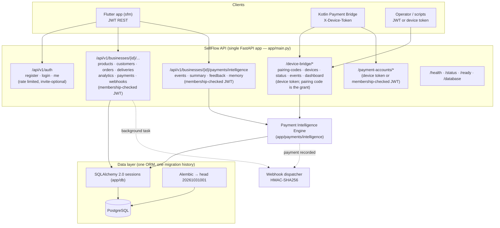

# CANONICAL ARCHITECTURE — SellFlow Backend (System B + migrated System A capabilities)

This document describes the one canonical architecture after the
System A → System B migration. Anything not described here (System A's second
app, second DB access style, second auth model) is **not part of the running
product**.

---

## 1. System map



## 2. Layering and conventions

| Layer | Location | Rules |
|---|---|---|
| Entry point | `app/main.py` | One app; registers routers; CORS from settings |
| Routers | `app/*/router.py`, `app/payments/intelligence/router.py`, `app/devices/bridge_router.py` | Thin; validation via pydantic; no business logic |
| Services | `app/payments/intelligence/service.py`, `app/devices/bridge_service.py`, `app/payments/service.py` | Own transactions; tenant id is always a parameter, never inferred |
| Engine | `app/payments/intelligence/{normalizer,matcher,confidence,anomalies,reconciliation}.py` | Pure/deterministic; DB access only through the caller's session |
| Models | `app/*/models.py`, `app/payments/intelligence/db_models.py` | SQLAlchemy 2.0 typed mappings |
| Migrations | `app/db/migrations/versions/` | Alembic; one head; additive-first |
| Config | `app/core/config.py` (+ `device_tokens.py`) | Fail-closed in production |

URL conventions: everything user-facing is under `/api/v1`; two
**compatibility surfaces** (`/device-bridge`, `/payment-accounts`) are mounted
at the root because the Kotlin bridge bakes its URLs at build time (see
`API_COMPATIBILITY.md`).

## 3. Authentication & authorization (one strategy, two principal types)

**User principal (JWT).** `POST /api/v1/auth/login` issues an HS256 JWT
(`sub = user id`, 24 h). Every business-scoped route depends on
`get_current_business`, which:

1. verifies the token (`app/auth/dependencies.py`),
2. resolves `business_id` from the path,
3. requires a `memberships` row (owner/admin/staff).

**Device principal (device token).** Issued only by redeeming a one-time,
60-second pairing code:

```
JWT user (or paired device) → POST /device-bridge/pairing-codes → plaintext code (store: HMAC hash)
Device                      → POST /device-bridge/devices {code,name} → plaintext token (store: HMAC hash)
Device                      → X-Device-Token on /device-bridge/* and /payment-accounts/*
```

Rules:

* The **code carries the tenant**; `business_id` is never accepted in a body.
* Tokens and codes are HMAC-SHA256 (key: `DEVICE_TOKEN_SECRET`); plaintext is
  shown once and never logged.
* A revoked/unpaired device (`devices.status != 'paired'`) fails 401.
* Endpoints callable by either principal use
  `require_user_or_device_business` (device token wins; otherwise a
  membership-checked JWT + explicit `business_id`).

**Admin/operator surfaces from System A were not migrated** — there is no
second admin credential in this codebase.

## 4. Payment flows

### 4.1 Real payments (device bridge → intelligence)

```mermaid
sequenceDiagram
  participant SMS as bKash SMS
  participant KB as Kotlin bridge
  participant API as /device-bridge/events
  participant ENG as Intelligence engine
  participant DB as PostgreSQL
  participant WH as Webhooks

  SMS->>KB: SMS_RECEIVED (sender "bKash")
  KB->>KB: parse → normalized fields (no body exported)
  KB->>KB: SQLite queue (dedupe provider:trxid)
  KB->>API: POST {provider,amount,transaction_id,sender?,timestamp,source}
  API->>API: device token → (device, business_id); rate limit
  API->>ENG: ingest_event(payload, business_id)
  ENG->>DB: dedupe payment_events (UNIQUE business,provider,txn)
  ENG->>ENG: match order (same business; amount/phone/timing)
  ENG->>ENG: confidence + anomalies
  ENG->>DB: mark order paid/partial + payments row (real TrxID)
  ENG->>DB: store event + decision + match + anomalies
  ENG-->>API: decision payload
  API-->>KB: 202 accepted / 200 duplicate
  ENG-->>WH: (out of band) payment.recorded via owner actions
```

Key properties: idempotent; explainable (decision + reason codes +
explanation); audit-stamped; tenant-bound at every step; offline queue on the
device; no SMS body stored server-side (only `message_text_present`).

### 4.2 Manual/API payments

* `POST /api/v1/businesses/{id}/orders/{order_id}/payments/` records a payment
  (idempotent per `(business, method, txid)`, capped at 150 % of order total),
  marks `orders.payment_status='paid'`, and fires the `payment.recorded`
  webhook.
* `POST .../payments/intelligence/events/{provider}` ingests a normalised event
  through the same engine for callers without a bridge device.
* `POST .../payments/verify` compares local payments with caller-supplied
  gateway rows (manual reconciliation import) — corrected to mark pending
  payments verified only when totals MATCH.

### 4.3 Development simulator

`POST /api/v1/payments/detect` exists **only outside production** (404 in
production), requires a JWT, and refuses any receiving number that is not
connected to the caller's own business. It is a local testing tool, not a
payment channel.

## 5. Data model (canonical)

New/consolidated tables (migration `20261031001`):

| Table | Purpose | Notable constraints |
|---|---|---|
| `payment_events` | one row per provider transaction (device or API) | UNIQUE `(business_id, provider, transaction_id)`; FK business, device |
| `payment_decisions` | engine decision per event (decision, status, confidence, reasons, explanation) | FK event CASCADE; FK order RESTRICT |
| `payment_matches` | matcher evidence (amount/customer/timing/historical) | FK event CASCADE |
| `payment_anomalies` | over/under/repeat/large/missing-identifier flags | FK event CASCADE |
| `payment_feedback` | seller corrections | FK event RESTRICT, order SET NULL |
| `seller_payment_profiles` | per-business aggregates | UNIQUE business |
| `payment_accounts` | connected receiving numbers | UNIQUE `(business, provider, number)` |
| `device_pairing_codes` | one-time codes (hashed) | UNIQUE code_hash |
| `devices` (extended) | bridge identity + status | UNIQUE device_token_hash (partial) |
| `orders` (extended) | `payment_status`, `payment_method` | — |

Every tenant-owned table carries `business_id` with an explicit FK. The test
suite proves cross-business access fails (403/404) for intelligence data,
device dashboards, orders, products, analytics and memberships.

RLS is **not** enabled; tenancy is enforced in the API layer. See
`MIGRATION_REPORT.md` §4.4 for the future-hardening note (System A's RLS design
is preserved in the System A repository for reference).

## 6. Configuration & secrets

| Variable | Behaviour |
|---|---|
| `APP_ENV` | `production` activates fail-closed validation |
| `SECRET_KEY` | production requires real value (≥32 chars, non-placeholder) or the app refuses to start |
| `DEVICE_TOKEN_SECRET` | same; HMAC key for codes/tokens. Development falls back to a random per-process value |
| `REGISTRATION_INVITE_CODE` | optional; when set, registration requires it (constant-time compare) |
| `CORS_ORIGINS` | comma-separated list; `*` forces `allow_credentials=False` |
| `DATABASE_URL` | SQLAlchemy URL; engine uses `pool_pre_ping` |

## 7. Background work

* FastAPI `BackgroundTasks` only; no worker process.
* Webhook delivery signs the exact JSON body with HMAC-SHA256
  (`X-Webhook-Signature: sha256=…`), opens its own DB session, and blocks
  loopback/private-literal URLs (SSRF guard). Delivery failures are logged and
  never break the request.
* Order-status notifications remain a logging stub (`notifications/service.py`)
  — unchanged from System B; not part of this migration.

## 8. What is explicitly out of scope

Courier integrations, COD settlement, FCM push, operator dashboards, seller
capacity, RLS, official provider APIs, iOS SMS detection. See
`SYSTEM_A_COMPONENT_MAPPING.md` for the per-component decision.
